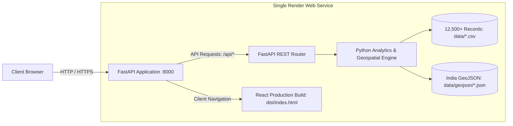

# GeoIQ – Geospatial Business Expansion Intelligence Platform

> **Tagline:** Map Opportunities. Discover Markets. Expand Smarter.  
> **Internship Category:** Data Analytics Internship – Task 4  
> **Production Status:** Production-Ready Full-Stack Geospatial BI Platform

---

## 🌟 Executive Overview

**GeoIQ** is an enterprise-grade geospatial business intelligence platform designed to analyze location-based sales, customer demand, store footprints, and competitor clusters across Indian states, cities, and districts. By integrating high-resolution geographic analytics, weighted opportunity scoring algorithms, and financial what-if simulators, GeoIQ empowers retail leaders and analysts to detect underserved markets and make data-backed expansion decisions.

---

## 🚀 Key Features & Capabilities

- **15 Production Analytics Pages:**
  1. `/` – **Landing Page:** Cinematic 3D animated particle Earth, interactive hotspots, connection arcs, and floating KPI cards.
  2. `/dashboard` – **Overview Dashboard:** Executive KPIs, interactive India sales map, revenue trends, regional donuts, and top opportunity rankings.
  3. `/sales` – **Geographic Sales Analysis:** State choropleths, regional revenue trends, product category distributions, and store coverage comparisons.
  4. `/demand` – **Customer Demand Analysis:** Demand density heatmaps, segment distributions, city-tier splits, and unmet demand detection.
  5. `/stores` – **Store Location Analysis:** Store clustering, 5–10 km coverage radius buffers, store type breakdowns, and footfall metrics.
  6. `/market-gap` – **Market Gap Analysis:** 4-quadrant demand vs. presence matrix, regional gap rankings, and unmet demand indicators.
  7. `/competitors` – **Competitor Analysis:** Competitor cluster maps, brand share breakdowns, and retail format distribution.
  8. `/population` – **Population & Purchasing Potential:** Population-weighted maps, urban/rural splits, and purchasing power correlations.
  9. `/revenue` – **Revenue & Profitability:** Revenue bubble maps, operating cost analysis, profit margin rankings, and quarterly trendlines.
  10. `/opportunities` – **Expansion Opportunities:** Ranked candidate sites, multi-attribute radar charts, and priority matrices.
  11. `/recommendations` – **Location Recommendations:** AI-scored top candidate dossiers, investment requirements, payback projections, and site rationales.
  12. `/simulator` – **What-If Expansion Simulator:** Real-time budget sliders, store count inputs, capture rate modeling, and 5-year projections across Conservative, Moderate, and Aggressive scenarios.
  13. `/datasets` – **Dataset Management:** File upload interface, sample dataset browser, validation checks, and data quality scoring (96.4%).
  14. `/reports` – **Reports & Export:** Automated analytical report generation with PDF, CSV, Excel, GeoJSON, and JSON API export options.
  15. `/settings` – **Platform Settings:** Theme configuration (Dark/Light), CartoDB/OSM map tile selection, animation intensity controls, and custom scoring weight adjustments summing to 100%.

- **Synthetic India Dataset:**
  - 12,500 validated transaction records across 13 Indian states
  - 121 retail store locations with footfall and performance metrics
  - 294 competitor locations with brand classifications
  - 7,020 customer demand observations across 6 product categories
  - 97 evaluated expansion candidate cities

---

## 🛠️ Technology Stack

| Layer | Technologies |
|---|---|
| **Frontend** | React 18, TypeScript, Vite, Tailwind CSS, Framer Motion, Lucide React, React Router 6 |
| **3D & Visuals** | Three.js (Particle Digital Earth), Canvas API (Particle waves, grid lines), SVG |
| **Maps & GIS** | Leaflet, React Leaflet, CartoDB Dark Matter tiles, GeoJSON Boundaries, Haversine Distance |
| **Charts & BI** | Recharts (Area, Bar, Pie, Radar, Scatter, Composed, Treemap) |
| **Backend API** | Python 3.12, FastAPI, Uvicorn, Pandas, NumPy, Pydantic v2, Shapely, Scikit-learn |
| **Testing** | Pytest, FastAPI TestClient (12/12 Automated Tests Passing) |
| **DevOps & Cloud** | Multi-Stage Dockerfile, Render Web Service, Single-Service Deployment Architecture |

---

## 🏗️ Architecture & Single-Service Deployment

GeoIQ is engineered for **zero-cost single-service cloud deployment** on Render's free tier:
- In production, FastAPI serves the pre-compiled React single-page application (`dist/`) directly while handling all `/api/*` REST endpoints on the same port (`8000`).
- No CORS errors, no multiple server charges, and one unified public URL.



---

## ⚡ Quick Start (Local Development)

### Prerequisites
- Python 3.10+
- Node.js 18+ and npm

### 1. Clone & Set Up Python Virtual Environment
```bash
git clone https://github.com/YOUR_USERNAME/geoiq.git
cd geoiq

python -m venv .venv
# On Windows:
.venv\Scripts\activate
# On Linux/macOS:
source .venv/bin/activate

pip install -r backend/requirements.txt
```

### 2. Build Frontend & Start Unified Server
```bash
# Build the React frontend
cd frontend
npm install
npm run build
cd ..

# Run unified backend (serves both API and UI)
python -m uvicorn backend.app.main:app --host 0.0.0.0 --port 8000 --reload
```

Open your browser to: **`http://localhost:8000`**

### 3. Run Automated Tests
```bash
python -m pytest backend/tests -v
```

---

## 📊 Methodology & Opportunity Scoring

The recommendation engine scores candidate cities ($S \in [0, 100]$) using normalized multi-factor weighted aggregation:

$$S = w_d \cdot D_{norm} + w_c \cdot (1 - C_{norm}) + w_p \cdot P_{norm} + w_r \cdot R_{norm} + w_g \cdot G_{norm}$$

- **Demand Score ($D_{norm}$, default weight 35%):** Modeled customer category demand and unmet demand volume.
- **Competition Factor ($(1 - C_{norm})$, default weight 25%):** Inverted competitor cluster density within radius.
- **Population Potential ($P_{norm}$, default weight 20%):** Population size and purchasing power index.
- **Revenue Potential ($R_{norm}$, default weight 15%):** Catchment revenue generation capacity.
- **Growth Rate ($G_{norm}$, default weight 5%):** Historical and projected market CAGR.

*Weights can be customized dynamically in real-time on the `/settings` page.*

---

## 📄 Synthetic Data Disclosure

*All sales transactions, customer demand estimates, store addresses, and financial ROI projections within GeoIQ are synthetically generated for demonstration and internship analysis purposes.*

---

## 📝 License

Distributed under the MIT License. Created for the Data Analytics Internship Task 4.
